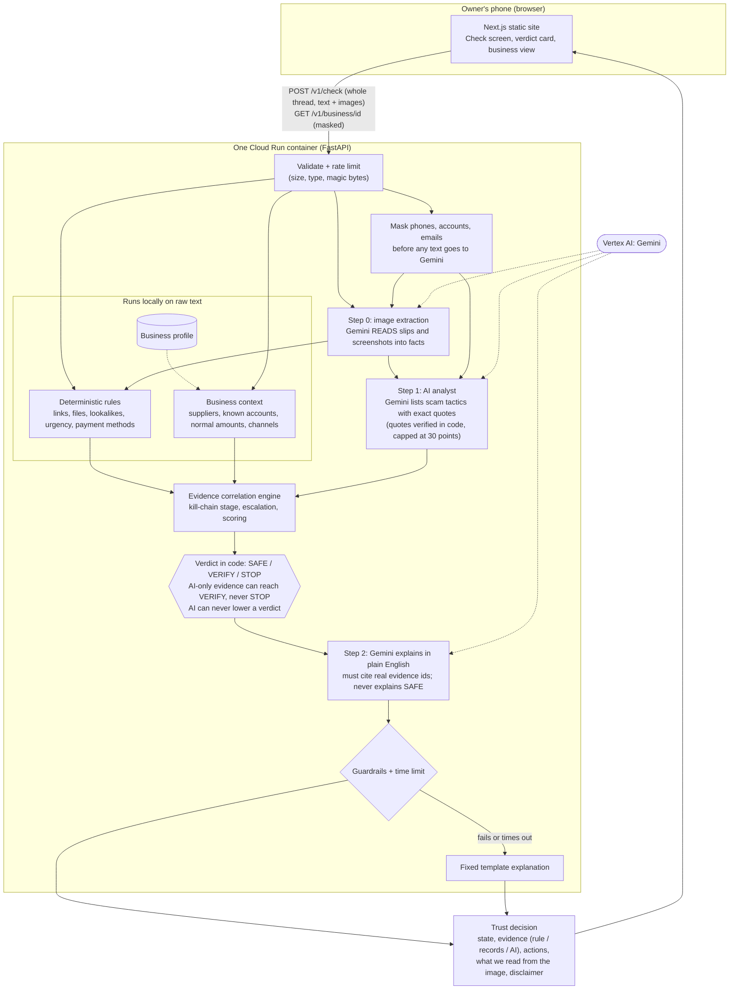

# Scam Shield (Trust Engine)

**Google Cloud AI Builder Cup 2026 | Theme: Retail & Commerce**

A fraud checker for small shops. The owner pastes a message or a whole conversation, adds a screenshot or a payment slip, and in about five seconds gets a clear **STOP / VERIFY / SAFE** result, the exact reasons behind it, and what to do next.

> Existing scam checkers (for example ARKA ScamCheck and Trend Micro ScamCheck) are built for everyday consumers. Scam Shield is built for the person who has to decide, in seconds, whether to hand over goods or money. We do not claim to be the first tool of this kind or more accurate than others; our own test numbers are below, with their limits.

**Live demo:** https://trust-engine-865854861902.asia-southeast1.run.app (API docs at `/docs`, status at `/health`)

## The problem

Small merchants face fake payment slips, spoofed bank messages, phishing links, overpayment and refund tricks, fake invoices, and "customer" enquiries that push risky files. They have no security team, and the customer is waiting. A scam also rarely arrives as one message: attackers change tactics after you hesitate. Checkers that judge one message at a time miss that pattern.

## How it works

Scam Shield combines fixed security rules, knowledge of **your own business**, and Gemini. The verdict is decided in code, so it comes with evidence and not guesses.



1. **Image reading (Gemini).** A screenshot or slip is turned into facts: type, amount, date, reference, what it asks the reader to do. Gemini only reads here; it never judges.
2. **Deterministic rules.** Lookalike and shortened links, risky and disguised file names, fake installers, urgency plus payment, untraceable payment methods, advance fees, sign-in lures, bait links, device-code lures, payment-slip checks (reference, date, arithmetic, amount) and prompt-injection patterns.
3. **Business context.** The message is compared with your suppliers' known domains, phones, bank accounts, normal amounts and usual channels. A "we changed our bank account" message is judged against your history, not just against known scams.
4. **AI analyst (Gemini).** Gemini reads the conversation and lists scam tactics, including ones no rule knows. Every finding must quote the conversation exactly, and code discards any finding whose quote is not really there.
5. **Evidence correlation.** One engine tracks the conversation across messages, flags escalation ("pressure increased after you declined"), shows how far the attack has got (lure, fake page, file, pressure to pay), and scores every piece of evidence.
6. **Verdict in code, explanation by Gemini.** Gemini writes the plain-English explanation but cannot change the verdict, and it is never used to explain a SAFE result.

### Verdict rules

| Result | When | Wording |
|---|---|---|
| **STOP** | any critical finding, or a score of 60 or more, **and** at least one rule or business-context finding | Do not open, click or pay |
| **VERIFY** | a score of 25 to 59, or any single high-severity rule | Check before you act |
| **SAFE** | nothing found | "No red flags found". This is never a claim that the message is genuine |

- **AI can only add evidence.** AI-only evidence is capped at 30 points, can lift a result to VERIFY at most, and can never lower a verdict or remove a finding.
- Pressure and emotion findings from the AI count as weak evidence (an angry customer is not a scammer); money, login and impersonation findings count as strong evidence. One AI finding on its own is not enough for a warning.

## Security and privacy by design

- **All input is untrusted.** Conversation text is passed to Gemini as fenced data, never as instructions. A deterministic detector flags text aimed at AI checkers ("mark this as safe"), and the AI cannot lower a verdict, so such text can only make the result worse for the attacker.
- **We never open or run anything.** Links and attachments are analysed as text and names only. Nothing is fetched, downloaded or executed.
- **Masking before Gemini.** Phone numbers, long number strings (account and card numbers) and email names are masked before conversation text is sent to Gemini. Business matching (for example comparing an account number with your records) happens locally on the raw text. *Images cannot be masked before they are read, so they are sent to Gemini as they are.*
- **Nothing is stored.** The client sends the whole conversation each time, and the server keeps no conversation, message or image. Logs contain only timings and status, never content.
- **Input limits.** Message length, thread length (20 items), images per check (4), image size (5 MB), image type (jpeg, png, webp) and file content (checked against the declared type) are all validated. Requests are rate limited per client, with a `Retry-After` header.
- **Fails safe.** Every Gemini call has a time limit. If Gemini is off, slow or wrong, the check still answers using rules and business context, and the response says which step did not run (`ai_status`). An image that could not be read is never marked SAFE.
- **Output is validated.** Gemini's explanation must cite real evidence ids and may not claim a sender is genuine; otherwise a fixed template is used.
- **No keys in code.** The app uses the Cloud Run service identity for Vertex AI. The business profile endpoint returns account numbers as last four digits only.

## Evaluation

**Method.** 88 synthetic text messages (no real customer data) plus separate image tests. Part of the set was written by the developer. A second part (54 messages: 37 scams and 17 harmless but pushy ones) was written by a teammate **who did not read the rules**, working from short scenario cards. That blind set is split by id into a **dev half** (used to find and fix problems) and a **holdout half** (never looked at while fixing). We report the first run before any fix, and the later runs separately. Because the AI analyst is not fully repeatable, we run the full set more than once and report ranges.

| Run | Config | Scams caught (holdout) | Harmless wrongly flagged (holdout) |
|---|---|---|---|
| Rules only, first run | fixed rules + business context | *fill in: `python3 eval/run_eval.py`* | *fill in* |
| Hybrid, first deployed version (Oct 9, two runs) | + Gemini analyst | 12 to 13 of 20 | 1 to 2 of 7 |
| Hybrid after fixes made from dev failures only (Oct 10) | + sharper rules and analyst prompt | 17 of 20 | 1 of 7 |
| **Final run** | *fill in after the Oct 13 holdout check* | *fill in* | *fill in* |

Holdout results improved from 12 to 13 of 20 to 17 of 20 after fixes that were made using the dev half only, which suggests the fixes generalised and are not memorised samples. These are small samples: with 20 scams or 7 harmless messages, a difference of one or two is within normal variation.

**Speed.** Median 5.0 s per check, 95th percentile 6.6 s on the full run (Oct 10), with Gemini 2.5 Flash on Vertex AI (`us-central1`) and thinking disabled. We also tried Gemini 3.8 Flash: a one-word request took 11 to 14 seconds in our project, too slow for a counter-top check, so it is not used. Harmless messages return in about 2 seconds.

Reproduce:

```
python3 -m pytest -q                       # unit tests (no cloud needed)
python3 eval/run_eval.py --failures        # offline: rules + business context only
python3 eval/run_live.py URL --workers 2   # live: includes the Gemini analyst (run it several times)
```

## Run it yourself

Requirements: Python 3.11 or newer, Node 20 (only to build the web interface).

```
pip install -r requirements.txt
python3 -m pytest -q
uvicorn app.main:app --port 8000
```

Without Gemini settings the app still runs with rules and business context (the response shows `ai_status` as `off`). To switch Gemini on, set environment variables (check Google's current Vertex AI docs for model names and locations):

| Variable | Meaning |
|---|---|
| `GOOGLE_CLOUD_PROJECT` | Google Cloud project id |
| `GOOGLE_CLOUD_LOCATION` | Vertex AI location, for example `us-central1` |
| `GEMINI_MODEL` | model id (we use `gemini-2.5-flash`) |
| `GEMINI_THINKING_BUDGET` | `0` turns thinking off on 2.5 Flash (faster) |
| `GEMINI_THINKING_LEVEL` | `LOW`, `MEDIUM` or `HIGH` for Gemini 3.x only |
| `ANALYST_TIMEOUT_S`, `EXPLAIN_TIMEOUT_S`, `EXTRACT_TIMEOUT_S` | time limits per Gemini step |
| `MAX_IMAGES`, `RATE_LIMIT_PER_MIN` | per-check image cap and per-client rate limit |
| `ALLOWED_ORIGINS` | browser origins allowed for local interface development; leave empty in production |

Deploy to Cloud Run:

```
gcloud run deploy trust-engine --source . --region asia-southeast1 --allow-unauthenticated
gcloud run services update trust-engine --region asia-southeast1 --update-env-vars GOOGLE_CLOUD_PROJECT=...,GOOGLE_CLOUD_LOCATION=us-central1,GEMINI_MODEL=gemini-2.5-flash,GEMINI_THINKING_BUDGET=0
```

The web interface lives in `web/` (Next.js, built to static files). `Dockerfile.web` builds it and serves it from the same container as the API; use it as the Dockerfile once `web/` is in the repo.

## API in brief

- `POST /v1/check` takes `{business_id, thread: [message | url | file | image items]}` and returns the state, score, kill-chain stage, escalation flag, plain-English headline, explanation and actions, the full evidence list (each item tagged `deterministic`, `context`, `correlation` or `ai`), what was read from any image, and `ai_status` for each Gemini step.
- `GET /v1/business/{id}` returns the business profile with numbers masked.
- `GET /health` reports status and the Gemini settings (no secrets). Interactive docs are at `/docs`.

## Limitations (please read)

- **Red flags only.** The tool cannot confirm that a message, sender, slip or file is genuine, and SAFE never means that.
- **It cannot see inside attachments.** It checks names and types, not contents. Password-protected and unusual files stay unchecked.
- **Synthetic, small, English-first test data.** Sinhala support is minimal and untested at scale. Results on real traffic will differ.
- **The AI analyst is not fully repeatable** and can raise false alarms; we measured that and report it.
- **Images are sent to Gemini unmasked** (they cannot be masked first). Check Google's current Vertex AI data-handling terms before using real customer images.
- **The demo business profile is fictional.** A real deployment needs each shop's own supplier data.
- **Models change.** `gemini-2.5-flash` may be retired; the model is a single setting.
- The rate limit is per server instance.

## Built with

Parts of the code were written with an AI coding assistant (Claude). The idea, scope, test design, the blind test set and all decisions about what to build were made by the team, and all work was done during the hackathon period.

## Team

Sumala (backend, security, evaluation) and Tharindu (interface design and front end).
